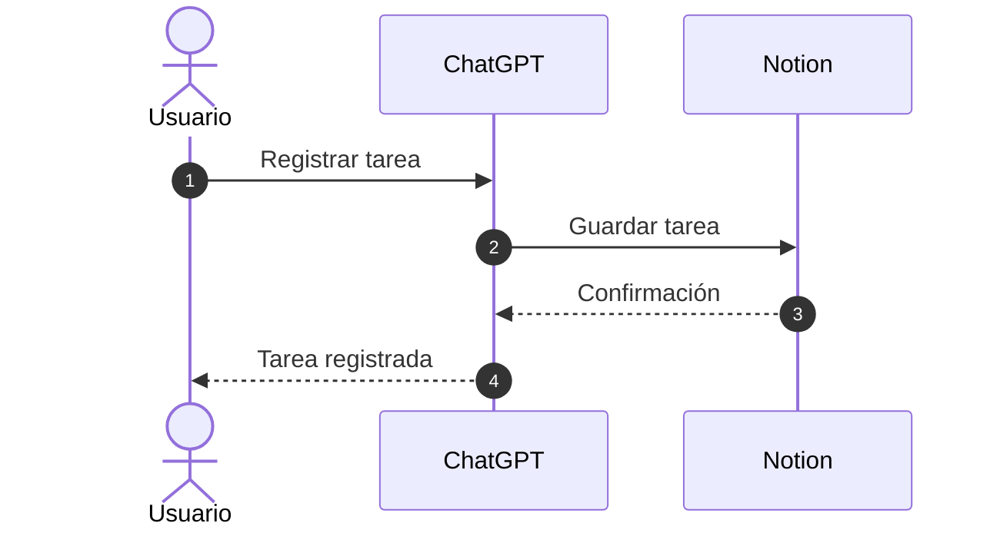
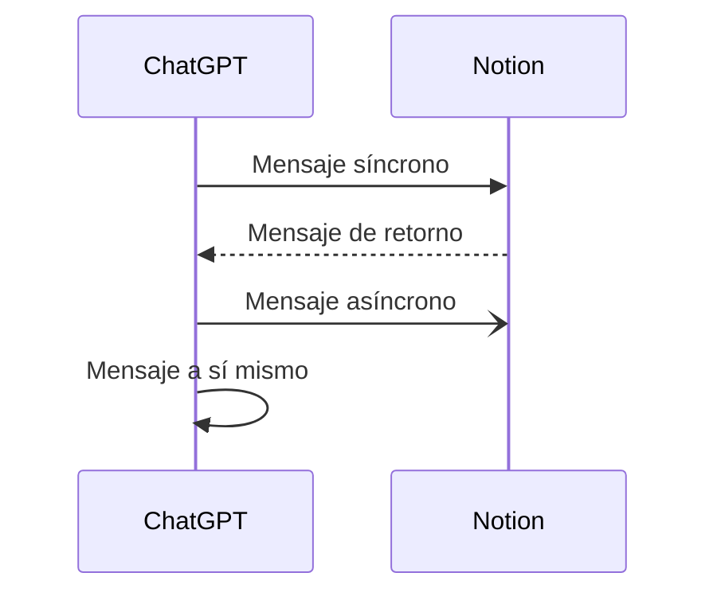
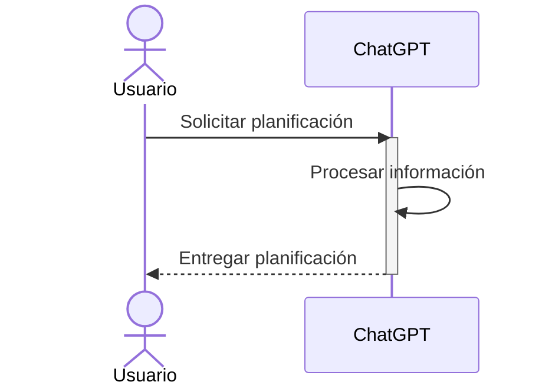
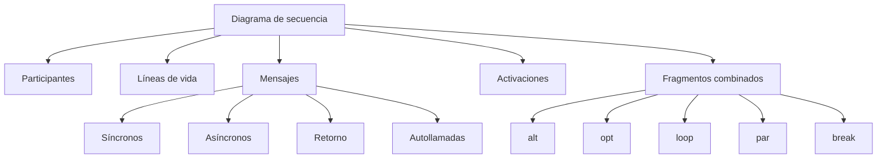

# Diagramas de secuencia

Un diagrama de secuencia es un diagrama UML (Unified Modeling Language) que representa las interacciones entre personas, aplicaciones o componentes de un sistema a lo largo del tiempo.

## 1. Interpretación de un diagrama de secuencia

Los diagramas de secuencia se leen de arriba hacia abajo, siguiendo el orden cronológico de las interacciones.

- El eje horizontal representa a los participantes.
- El eje vertical representa el transcurso del tiempo, no necesariamente a escala.
- Las flechas representan los mensajes entre participantes.

## 2. Elementos fundamentales

### Participante (Participant)

Persona, aplicación, servicio o componente que interviene en una interacción.

### Línea de vida (Lifeline)

Línea vertical discontinua que representa la existencia de un participante durante la interacción.

### Mensaje (Message)

Representa una comunicación, solicitud o invocación de una operación.

#### Mensaje síncrono (Synchronous Message)

El emisor espera a que termine la operación antes de continuar.

#### Mensaje asíncrono (Asynchronous Message)

El emisor puede continuar sin esperar a que termine la operación.

#### Mensaje de retorno (Return Message)

Representa la respuesta o el resultado de una operación anterior.

#### Mensaje a sí mismo (Self-message)

Representa una operación interna o la invocación de un método propio del participante.

No implica necesariamente una repetición o un bucle. Puede ser síncrono o asíncrono.

### Activación (Activation)

Representa el periodo durante el cual un participante ejecuta una operación.

### Fragmentos combinados (Combined Fragments)

Permiten representar estructuras de control dentro de las interacciones.

| Fragmento | Función |
|---|---|
| `alt` | Alternativas condicionales |
| `opt` | Operaciones opcionales |
| `loop` | Repetición de operaciones |
| `par` | Operaciones paralelas |
| `break` | Interrupción de una secuencia |

### Jerarquía conceptual

