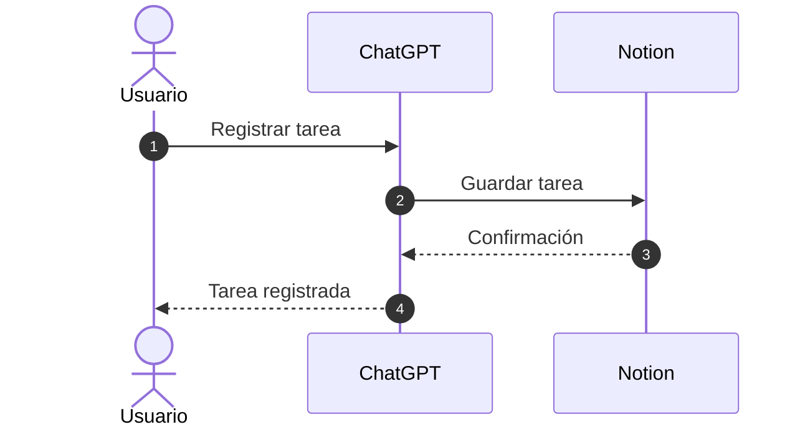
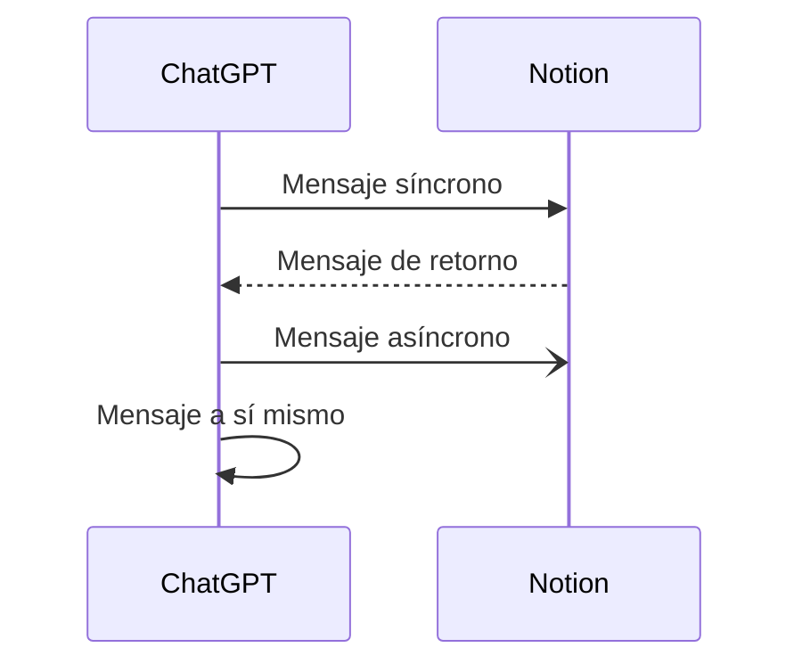
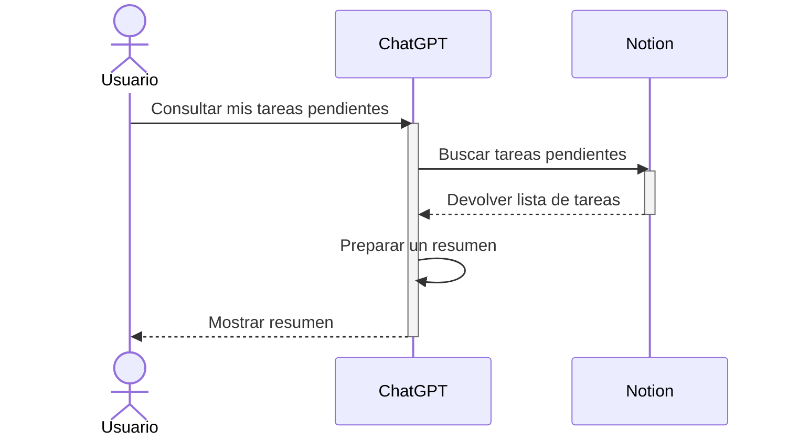
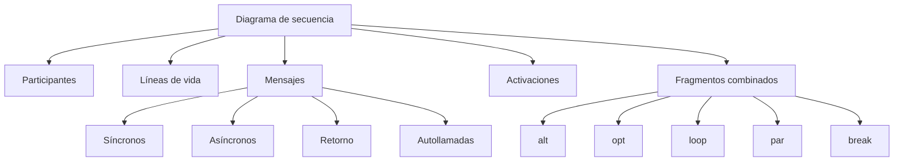
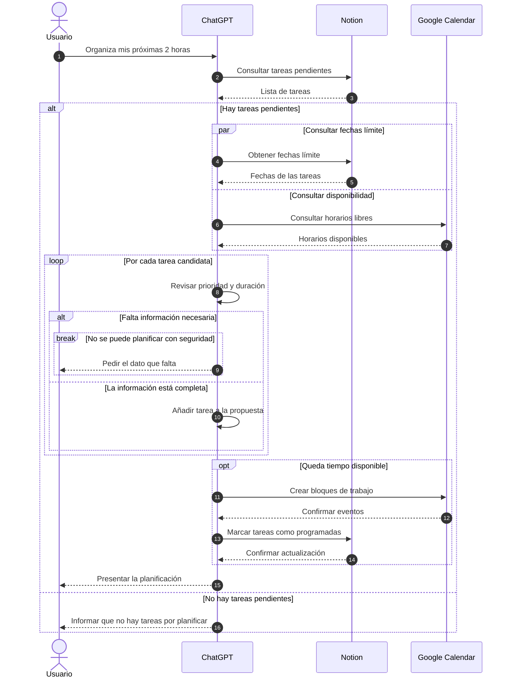

# Diagramas de secuencia

Un diagrama de secuencia es un diagrama UML (Unified Modeling Language) que representa las interacciones entre personas, aplicaciones o componentes de un sistema a lo largo del tiempo.

## 1. Interpretación de un diagrama de secuencia

Los diagramas de secuencia se leen de arriba hacia abajo, siguiendo el orden cronológico de las interacciones.

- El eje horizontal representa a los participantes.
- El eje vertical representa el transcurso del tiempo, no necesariamente a escala.
- Las flechas representan los mensajes entre participantes.

## 2. Elementos fundamentales

### Participante (Participant)

Persona, aplicación, servicio o componente que interviene en una interacción.

### Línea de vida (Lifeline)

Línea vertical discontinua que representa la existencia de un participante durante la interacción.

### Mensaje (Message)

Representa una comunicación, solicitud o invocación de una operación.

#### Mensaje síncrono (Synchronous Message)

El emisor espera a que termine la operación antes de continuar.

#### Mensaje asíncrono (Asynchronous Message)

El emisor puede continuar sin esperar a que termine la operación.

#### Mensaje de retorno (Return Message)

Representa la respuesta o el resultado de una operación anterior.

#### Mensaje a sí mismo (Self-message)

Representa una operación interna o la invocación de un método propio del participante.

No implica necesariamente una repetición o un bucle. Puede ser síncrono o asíncrono.

### Activación (Activation)

Representa el periodo durante el cual un participante está ejecutando una operación. Se muestra como una barra vertical sobre su línea de vida.

La activación es opcional. En un flujo lineal sencillo, los mensajes suelen bastar para entender el orden. Añádela cuando ayude a ver cuánto dura el procesamiento de un participante o cómo una operación queda pendiente mientras espera una llamada a otro participante.

En este ejemplo, ChatGPT permanece activo mientras Notion busca las tareas. Notion también se activa durante su consulta; al responder, su activación termina y ChatGPT continúa procesando hasta entregar el resultado.

### Fragmentos combinados (Combined Fragments)

Permiten representar estructuras de control dentro de las interacciones.

| Fragmento | Función |
|---|---|
| `alt` | Alternativas condicionales |
| `opt` | Operaciones opcionales |
| `loop` | Repetición de operaciones |
| `par` | Operaciones paralelas |
| `break` | Interrupción de una secuencia |

### Jerarquía conceptual

## 3. Ejemplo completo: planificar tareas con fragmentos combinados

Imagina que el usuario pide organizar las próximas dos horas. ChatGPT consulta la información y decide qué hacer según lo que encuentre.

### ¿Qué hace cada fragmento en este ejemplo?

- **`alt` (alternativas):** el primer `alt` elige entre dos caminos: hay tareas pendientes o no las hay. El segundo elige qué hacer con cada tarea según tenga información suficiente.
- **`par` (paralelo):** consulta las fechas límite y la disponibilidad en paralelo. Son dos consultas independientes, así que no hace falta esperar a que termine una antes de empezar la otra.
- **`loop` (repetición):** revisa cada tarea candidata usando los mismos pasos.
- **`break` (interrupción):** si falta un dato necesario, interrumpe el procesamiento de ese fragmento y pide la aclaración al usuario.
- **`opt` (opcional):** solo crea eventos y actualiza Notion si queda tiempo disponible. Si no queda tiempo, se omite ese bloque.

Los fragmentos dibujan el alcance de cada decisión o grupo de pasos. En Mermaid, cada fragmento comienza con su palabra clave y termina con `end`; `else` separa alternativas dentro de `alt`, y `and` separa ramas dentro de `par`.
