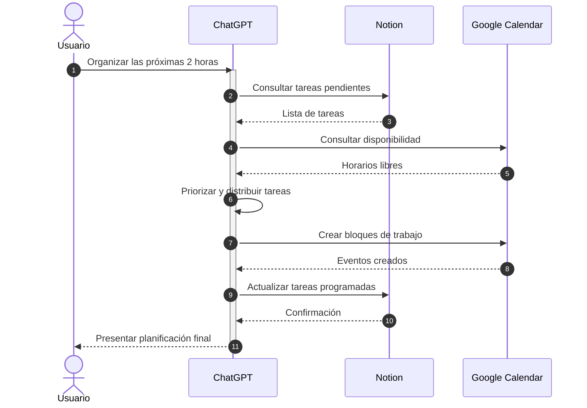

# Caso práctico: asistente personal de tareas con IA

Se plantea un sistema integrado por ChatGPT, Notion y Google Calendar, cuyo objetivo es gestionar y planificar tareas personales mediante lenguaje natural.

## Participantes

- **Usuario:** solicita la planificación de sus tareas.
- **ChatGPT:** interpreta, analiza, prioriza y distribuye las tareas.
- **Notion:** almacena y gestiona las tareas.
- **Google Calendar:** gestiona la disponibilidad y los bloques de trabajo.

## Diagrama de secuencia

## Procesamiento interno

La autollamada de ChatGPT representa las operaciones internas necesarias para elaborar la planificación:

- Analizar las tareas pendientes.
- Evaluar prioridades y fechas límite.
- Estimar la duración de las tareas.
- Seleccionar las tareas compatibles con el tiempo disponible.
- Determinar el orden de ejecución.
- Elaborar la distribución temporal.

Estas operaciones pueden representarse mediante una única autollamada o mediante varias, dependiendo del nivel de detalle requerido.

El procesamiento interno es la operación que se realiza, mientras que el mensaje a sí mismo es el elemento gráfico que permite representarla.
